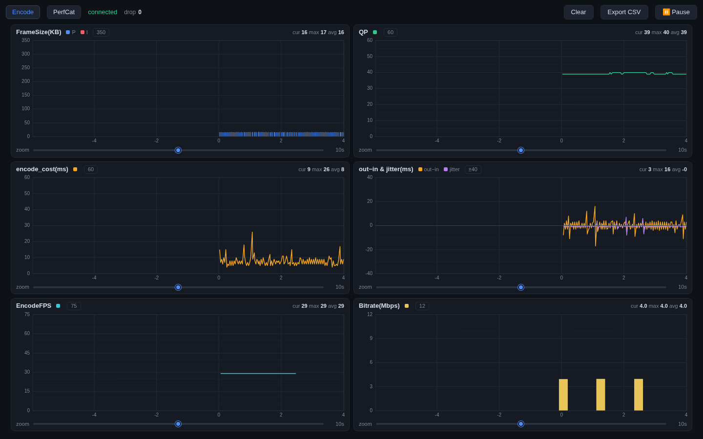
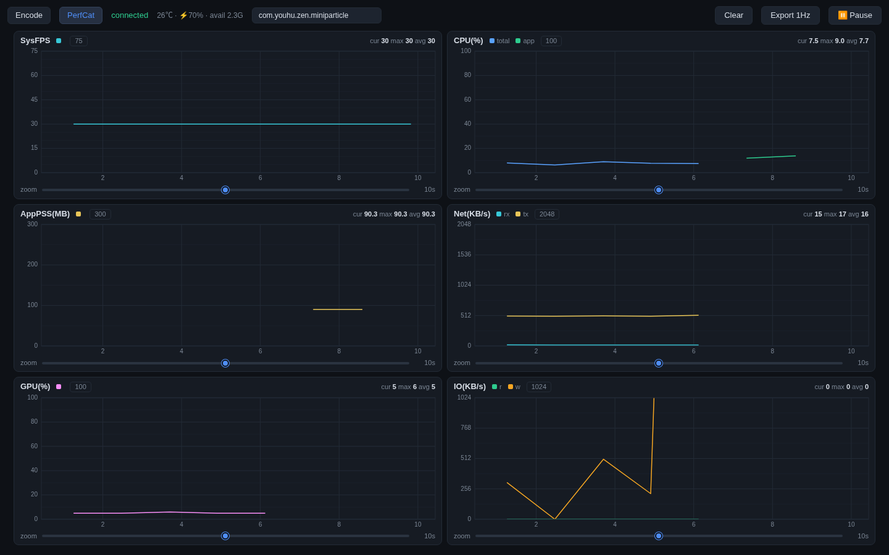

# 云手机编码测试工具

基于 [scrcpy](https://github.com/Genymobile/scrcpy) v3.2 改造的 Android 性能监控工具:server 端逐帧采集编码器统计(帧大小、QP、编码耗时、帧率、码率)+ 1Hz 系统指标(CPU/内存/网络/GPU/磁盘 IO),经 abstract socket 以 JSON 行协议输出,Web 端双 Tab 实时图表展示。





## 监控指标

两个 Tab 单页切换(后台 Tab 数据照常采集),每 Tab 6 张卡(2 列 × 3 行):

**Encode(编码链路)**

| 图表 | 说明 |
|---|---|
| FrameSize(KB) | 每帧编码后大小,I 帧红色 / P 帧蓝色 |
| QP | 量化参数(需设备端 `libwebrtcLibsJni.so`,缺失时为 -1) |
| encode_cost(ms) | 单帧编码耗时 |
| out−in & jitter(ms) | 编码器出帧−产帧间隔(攒帧检测)与帧间隔抖动双线 |
| EncodeFPS / Bitrate(Mbps) | 编码器出帧率;server 每秒汇总码率 |

**PerfCat(系统与指定 APP,1Hz)**

| 图表 | 说明 |
|---|---|
| SysFPS | 显示层产帧率(pts 差分,≈目标 APP 渲染帧率) |
| CPU(%) | 整机 + 指定 APP 双线(APP 需在页面输入包名) |
| AppPSS(MB) | 指定 APP 内存(RSS 进 CSV 不画卡) |
| Net(KB/s) | 整机网络 rx/tx |
| GPU(%) | Mali `utilisation` sysfs(非 Mali 平台缺省断线) |
| IO(KB/s) | 磁盘读/写(`/proc/diskstats` 扇区差分) |

## 快速开始

```bash
# 一条命令:push server + 启动 scrcpy + 建隧道 + 起 Web 服务(默认 4Mbps)
./scripts/run_monitor.sh

# 浏览器打开
http://<本机IP>:9002/
```

环境变量:

| 变量 | 默认 | 说明 |
|---|---|---|
| `SCRCPY_ARGS` | 空 | 追加 scrcpy 参数,如 `"--max-fps 60"`、`"--video-codec h265"`,可覆盖默认码率 |
| `REC_FILE` | `/dev/null` | 录制文件(编码器必须有 sink 统计才产生) |
| `WEB_PORT` | `9002` | Web 端口 |

仅部署 server(不启动监控):

```bash
./scripts/deploy_server.sh -h
```

## 架构


- 统计通道独立于 scrcpy 的 video/audio/control 三通道,多客户端同时监控各自拿到完整数据流(广播)
- 协议字段详见 `example/README.md`

## 相关目录

| 目录 | 用途 |
|---|---|
| `server/src/main/java/com/genymobile/scrcpy/encodeStat/` | server 端统计采集与发送 |
| `example/` | Node WebSocket 中继 + Web 监控页 |
| `scripts/run_monitor.sh` | 一键监控链路 |
| `scripts/deploy_server.sh` | server 构建与部署 |

上游 scrcpy 的完整文档见 [doc/](doc/)。
